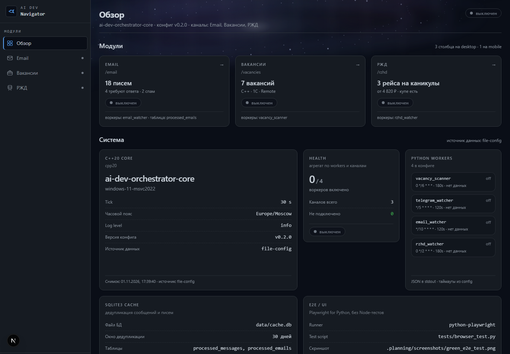

# 🛸 AI Dev Navigator — Smart Agentic Dashboard

> **Важно для проверяющего:** Проект разработан в рамках курса OTUS «ИИ-агенты: продвинутое внедрение и использование». В основе архитектуры лежит строгое разделение на C++ высоконагруженное ядро (NotificationRouter) и асинхронные Python-воркеры на чистых корутинах.

## 🛠️ Использование фреймворков и методологий

- **Контекст-инжиниринг:** В проекте официально развернут и активно используется фреймворк **[GSD-Core (Git. Ship. Done.)](https://github.com/open-gsd/gsd-core)**. Все итерации проектирования бэкенда и UI проходят через регламентированный цикл фаз (Discuss ➔ Plan ➔ Execute ➔ Verify ➔ Ship), локальные правила зафиксированы в `.clinerules/gsd.md`.
- **Визуальная концепция:** Интерфейс дашборда спроектирован в строгом соответствии со спецификацией **`design.md`** (Bento-Grid макет, цветовая палитра #0A0E17 / #161B22, моноширинный шрифт JetBrains Mono для логов и системный контраст WCAG >= 7:1).

## 💻 Главный экран системы (Bento Overview)

*(Сюда преподаватель сразу смотрит при входе в репозиторий)*



## 📦 Текущий статус реализации (Phase 3 & Phase 5)

1. **Канал «Email»:** Готов каркас асинхронного воркера `agents/mail_worker.py` (чистые корутины через `aioimaplib` и `httpx`), реализующий каскадную стратегию экономии токенов (WhiteList ➔ DeepSeek-V3 (`deepseek-chat`) ➔ DeepSeek-R1 (`deepseek-reasoner`)).
2. **Канал «Вакансии» & «РЖД»:** Размечены в конфигурации `config/orchestrator.json`, подготовлены UI-карточки в состоянии `not_connected`.
3. **Интерфейс:** Next.js 15, Tailwind v4, анимированный Aurora-бэкграунд (вытянутый эллиптический галактический шлейф с разреженными звёздами и Северное сияние), кастомный брендинг и иконка корабля Trimaxion (Max) из фильма «Полет навигатора».


## 🗂️ Структура репозитория

```text
ai-dev-orchestrator/
├── src/                     # C++20 ядро: NotificationRouter, status_panel.html
├── agents/                  # Python-воркеры на корутинах: mail_worker.py, telegram_sender.py, vk_max_sender.py
├── config/orchestrator.json # единственный источник истины: ядро, воркеры, storage, UI-навигация
├── web/                     # Next.js 15 + Tailwind v4 bento-дашборд (см. web/README.md)
├── tests/                   # pytest + Playwright Python (e2e), мок-вебхуки
├── design.md                # спецификация UI: палитра, типографика, сетка, состояния
├── .clinerules/gsd.md       # локальные правила GSD-Core
├── gsd-core/                # развёрнутый фреймворк GSD-Core (workflows, agents, bin/gsd-tools.cjs)
└── pre-commit.bat           # валидация конфигурации перед фиксацией кода
```

## ⚡ Быстрый старт

```powershell
# 1. Дашборд (Next.js 15, Tailwind v4)
Set-Location web
npm install
npm run dev          # http://localhost:3000

# 2. Проверки фронтенда
npm run typecheck    # tsc --noEmit
npm run build

# 3. Почтовый воркер (чистые корутины, проверка конфигурации без сети)
Set-Location ..
.\.venv\Scripts\python.exe agents\mail_worker.py --dry-run
.\.venv\Scripts\python.exe agents\mail_worker.py --once --provider primary
```

## 🎨 Соответствие `design.md`

| Требование `design.md` | Реализация |
|---|---|
| Палитра `--color-canvas` #0A0E17 / `--color-surface` #161B22 | CSS-переменные в `web/app/globals.css` (Tailwind v4 `@theme`) |
| Bento-Grid: 3 колонки на desktop, 1 на mobile | `web/components/bento/BentoGrid.tsx` |
| JetBrains Mono для логов и метаданных | `--font-mono` в `web/app/globals.css` |
| Контраст WCAG >= 7:1 | Контент лежит на непрозрачных поверхностях, фон гасится масками. Замер по скриншоту: `--color-ink` 11.3–12.5:1, `--color-muted` 5.7–6.3:1 |
| `prefers-reduced-motion` | Отключение анимаций сияния в `web/app/globals.css` |

## 📚 Материалы предыдущих модулей курса

- **Модуль 1 (выбор стека):** IDE-агент VS Code + Cline, основная модель DeepSeek (cloud), локальный DeepSeek-R1 (14b) через Ollama как резерв; MCP-сервер `context7` для актуализации документации (`cline_mcp_settings.json`), архитектурные ограничения — в `CLAUDE.md`.
- **Навыки (SKILLs):** `skills/code-review/SKILL.md` (аудит C++20 / 1С), `skills/test-generation/SKILL.md` (генерация тестов).
- **Кастомные команды Cline:** `/review` (аудит изменённых файлов по правилам `CLAUDE.md`), `/testgen` (генерация тестовых сценариев).
