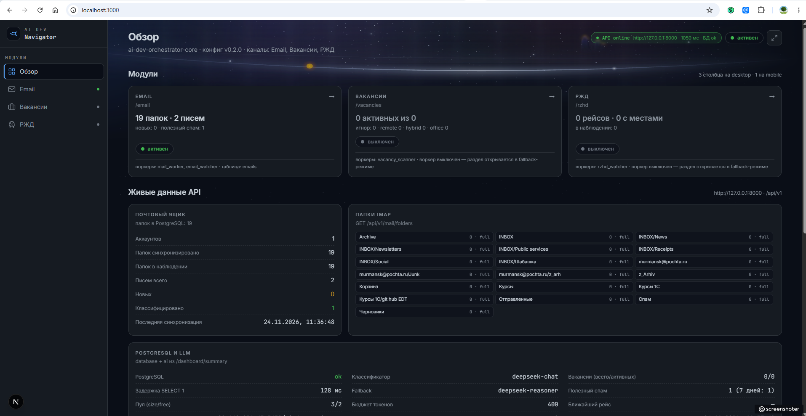
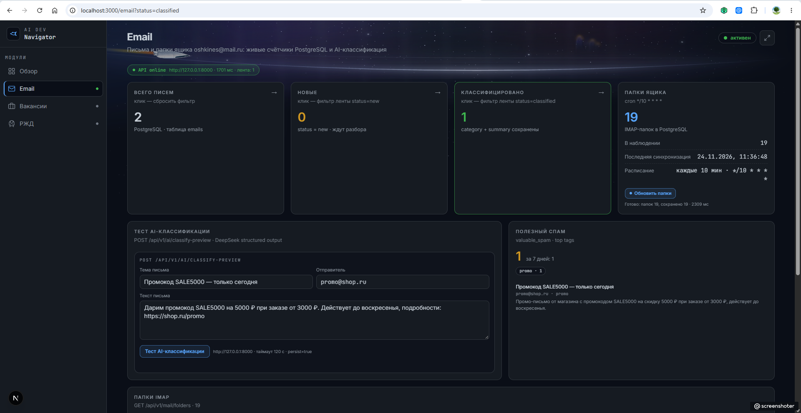
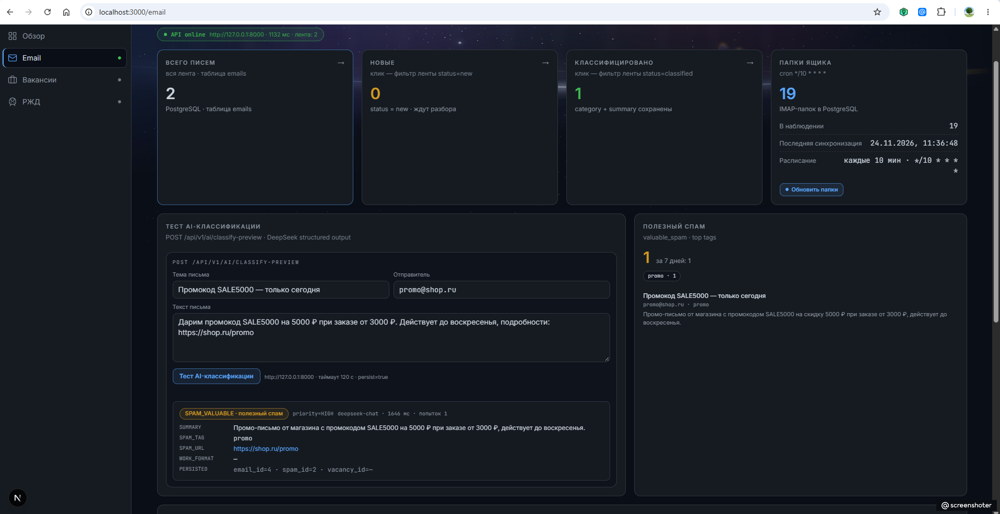
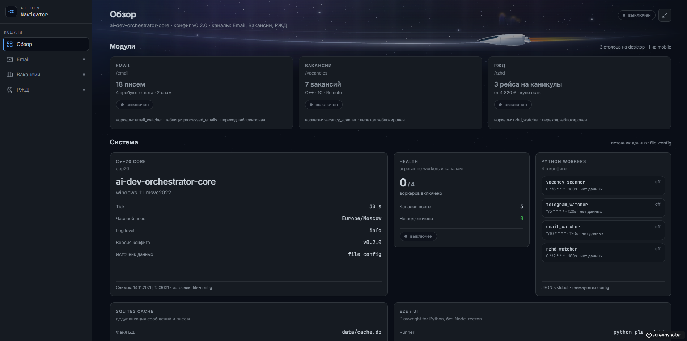
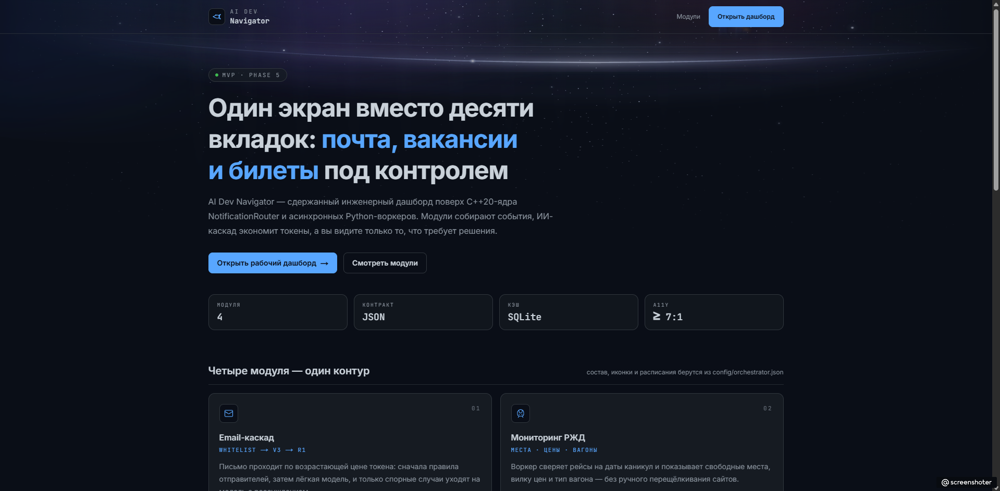

# 🛸 AI Dev Navigator — Smart Agentic Dashboard

**🌐 Рабочий стенд (Live Demo):** [Дашборд](http://82.148.236.43:3000) | [Обзор MVP](http://82.148.236)

> **Важно:** Проект разработан в рамках курса OTUS «ИИ-агенты: продвинутое внедрение и использование». В основе архитектуры лежит строгое разделение на C++ высоконагруженное ядро (NotificationRouter) и асинхронные Python-воркеры на чистых корутинах.

## 🛠️ Использование фреймворков и методологий

- **Контекст-инжиниринг:** В проекте официально развернут и активно используется фреймворк **[GSD-Core (Git. Ship. Done.)](https://github.com/open-gsd/gsd-core)**. Все итерации проектирования бэкенда и UI проходят через регламентированный цикл фаз (Discuss ➔ Plan ➔ Execute ➔ Verify ➔ Ship), локальные правила зафиксированы в `.clinerules/gsd.md`.
- **Визуальная концепция:** Интерфейс дашборда спроектирован в строгом соответствии со спецификацией **`design.md`** (Bento-Grid макет, цветовая палитра #0A0E17 / #161B22, моноширинный шрифт JetBrains Mono для логов и системный контраст WCAG >= 7:1).

## 🖼️ Интерфейс и визуальная концепция (Production UI)

Интерфейс собран как рабочая панель инженера, а не маркетинговый лендинг: тёмная canvas-подложка, плотный bento-макет, моноширинные логи и явно показанные состояния. Вся визуальная логика выведена из `design.md`, поэтому на скриншотах ниже — реальные экраны production-сборки, а не макеты.

## ⚙️ Backend API, PostgreSQL + RLS и AI-интеграция (TDD)

Бэкенд-слой проекта реализован на **FastAPI** + **PostgreSQL 16** (`asyncpg`) с соблюдением принципов spec-driven разработки, безопасности данных и устойчивой интеграции с LLM:

- **Схема БД и безопасность (`architecture.md` + `db/migrations/`):**
  - Спроектированы и развёрнуты 7 нормализованных таблиц (`mail_accounts`, `mail_folders`, `emails`, `valuable_spam`, `rzhd_tickets`, `vacancies`, `ai_instructions`) с B-Tree и GIN-индексами.
  - Настроена выделенная роль `navigator_worker` по принципу наименьших привилегий (`002_tighten_worker_grants.sql`) и политики **Row-Level Security (RLS)** — воркер имеет доступ строго к активным почтовым ящикам (`is_active = TRUE`), а критические таблицы защищены от удаления. Все политики проверены серией из 27 негативных SQL-тестов (`ERROR 42501`).
- **REST API и TDD-покрытие (`docs/api_spec.md`, `api/main.py`, `tests/test_api_tdd.py`):**
  - Реализованы эндпоинты сводки дашборда (`/api/v1/dashboard/summary`), синхронизации и чтения папок IMAP (`/api/v1/mail/folders` — подтянуты реальные 19 папок ящика `oshkines@mail.ru`), CRUD для вакансий и билетов РЖД, а также настроен CORS.
  - Написан и пройден набор из **31 автотеста** на `pytest` + `httpx.AsyncClient` (`exit code 0`).
- **AI-классификатор с контролем стоимости и ошибок (`POST /api/v1/ai/classify-preview`):**
  - Интеграция с LLM (DeepSeek) через строгую **Pydantic-схему (Structured Output)** с лимитом `max_tokens` из таблицы `ai_instructions`, жёстким таймаутом (15 с), экспоненциальным `retry` (до 3 попыток) и автоматическим переключением на `fallback`-модель при сбоях.
- **Живая интеграция с фронтендом (`web/lib/api/`):**
  - Главный дашборд `/` и раздел `/email` подключены к живому FastAPI с graceful fallback при недоступности сервера.

### 📸 Работающий сценарий (PostgreSQL + FastAPI + AI-классификация)


*Главный дашборд: статус `API online`, реальные счётчики и синхронизированные папки из PostgreSQL.*


*Страница `/email`: сама страница.*


*Страница `/email`: живой тест AI-классификации (Structured Output) с определением категории `SPAM_VALUABLE`, генерацией выжимки и сохранением в БД.*


### 🖥️ Главный рабочий экран (`/`)



*Bento-обзор: карточки модулей Email / Вакансии / РЖД и системные карточки ядра (Core, Health, Workers, Storage, E2E) на одном экране.*

### 🚀 Публичная обзорная MVP-страница (`/overview`)



*Витрина MVP по схеме «оффер → доказательства → модули → путь события → CTA». Живёт вне route group `(dashboard)`, поэтому рендерится без сайдбара и без чтения конфига; собирается статически.*

*Оба снимка сделаны с production-сборки (`npm run build` + `npm run start:e2e`), анимации отключены через `prefers-reduced-motion` — поэтому кадры чистые и повторяемые.*

### 🧱 Фронтенд-стек и дизайн-система

| Слой | Реализация |
|---|---|
| Дизайн-система | `design.md` — единственный источник истины + CSS-first токены Tailwind v4 `@theme` в `web/app/globals.css`: палитра `#0A0E17` (canvas) и `#161B22` (surface), семантические радиусы `rounded-bento` / `rounded-control`, токены motion. `tailwind.config.js` не создаётся, hex-литералов в компонентах нет |
| Типографика | `JetBrains Mono` для логов, кода и метаданных, `Inter` для основного текста (`next/font`, subset `cyrillic`, self-hosted — внешних CDN-запросов нет) |
| Иконки | единый набор `lucide-react` через `web/components/icons.tsx`: один `strokeWidth` и один размер; бренд-знак Trimaxion хранится отдельно, случайные эмодзи в роли иконок запрещены (`design.md` §10) |
| Микро-анимации | `motion/react`: появление bento-карточек (сдвиг 14 px, 420 ms, стаггер 40 ms), hover/tap-отклик кнопок (`ui/Pressable`), переходы табов. Глобально — `<MotionConfig reducedMotion="user">` в `web/components/providers/MotionProvider.tsx`: системная настройка «уменьшить движение» сама гасит transform-анимации |
| Псевдо-3D и фон | `GSAP` (`gsap` + `@gsap/react`), только в клиентских компонентах: автономный космический фон «Горизонт событий» (`web/components/layout/AuroraBackdrop.tsx`), туманность «Столпы Творения», редкая сверхновая, цефеиды и далёкая комета, а также пролёт корабля Trimaxion строго по нити горизонта (`web/components/layout/TrimaxionPassage.tsx`). Анимируются только `transform` / `opacity`, таймлайны «спят» между событиями, при `prefers-reduced-motion` декоративные узлы не монтируются |
| Роутинг и адаптивность | публичный роут `/overview` для презентации MVP отделён от рабочего дашборда `/`; bento-сетка 3 → 1 колонка, вёрстка проверена до `375px` без горизонтального скролла (`viewport` в `web/app/layout.tsx`) |

## 📦 Текущий статус реализации (Phase 3 & Phase 5)

1. **Канал «Email»:** Готов каркас асинхронного воркера `agents/mail_worker.py` (чистые корутины через `aioimaplib` и `httpx`), реализующий каскадную стратегию экономии токенов (WhiteList ➔ DeepSeek-V3 (`deepseek-chat`) ➔ DeepSeek-R1 (`deepseek-reasoner`)).
2. **Канал «Вакансии» & «РЖД»:** Размечены в конфигурации `config/orchestrator.json`, подготовлены UI-карточки в состоянии `not_connected`.
3. **Интерфейс:** Next.js 15, Tailwind v4, анимированный Aurora-бэкграунд (`web/components/layout/AuroraBackdrop.tsx`): ядро галактической орбиты вынесено за верхнюю границу окна, поэтому в кадре остаётся только нижняя дуга эллипса — мягкий «горизонт событий» под верхней панелью: концы дуги уходят за края окна, нижние дорожки плавно опускаются и скрываются под bento-карточками. Кастомный брендинг и иконка корабля Trimaxion (Max) из фильма «Полет навигатора».

## 🗂️ Структура репозитория

```text
ai-dev-orchestrator/
├── src/                     # C++20 ядро: NotificationRouter, status_panel.html
├── agents/                  # Python-воркеры на корутинах: mail_worker.py, telegram_sender.py, vk_max_sender.py
├── config/orchestrator.json # единственный источник истины: ядро, воркеры, storage, UI-навигация
├── web/                     # Next.js 15 + Tailwind v4 bento-дашборд (см. web/README.md)
├── tests/                   # pytest + Playwright Python (e2e), мок-вебхуки
├── design.md                # спецификация UI: палитра, типографика, сетка, состояния
├── docs/screenshots/        # Production UI: dashboard-home.png (/), overview-mvp.png (/overview)
├── docs/handoff/            # PRD_CHALLENGE.md: персоны, User Stories с AC, деградация
├── docs/research/           # BENCHMARKING.md: ресерч аналогов и обоснование палитры
├── docs/troubleshooting.md  # журнал ошибок и решений: сначала смотрим сюда при любой ошибке
├── .clinerules/gsd.md       # локальные правила GSD-Core
├── gsd-core/                # развёрнутый фреймворк GSD-Core (workflows, agents, bin/gsd-tools.cjs)
└── pre-commit.bat           # валидация конфигурации перед фиксацией кода
```

## ⚡ Быстрый старт

```powershell
# 1. Дашборд (Next.js 15, Tailwind v4)
Set-Location web
npm install
npm run dev          # http://localhost:3000

# 2. Проверки фронтенда
npm run typecheck    # tsc --noEmit
npm run build

# 3. Почтовый воркер (чистые корутины, проверка конфигурации без сети)
Set-Location ..
.\.venv\Scripts\python.exe agents\mail_worker.py --dry-run
.\.venv\Scripts\python.exe agents\mail_worker.py --once --provider primary
```

## 🔌 Backend API (FastAPI + PostgreSQL + LLM)

Спецификация контракта — **`docs/api_spec.md`** (Pydantic-модели, коды ошибок, каскад LLM).
Реализация — `api/main.py`, исполняемая спецификация — `tests/test_api_tdd.py` (TDD: тесты написаны до кода).

```powershell
# 1. Запуск API (порт 8000, Swagger UI: http://127.0.0.1:8000/docs)
.\.venv\Scripts\python.exe -m uvicorn api.main:app --host 127.0.0.1 --port 8000

# 2. TDD-набор: 31 тест, БД и LLM подменены фейками (без сети и токенов)
.\.venv\Scripts\python.exe -m pytest            # 31 passed
```

| Метод | Путь | Назначение |
|---|---|---|
| GET | `/api/v1/health` | здоровье сервиса, БД (`latency_ms`) и LLM-провайдера |
| GET | `/api/v1/dashboard/summary` | сводка Bento: папки/письма, `valuable_spam`, вакансии, РЖД, лимиты ИИ |
| GET/PATCH | `/api/v1/mail/folders[/{id}]` | папки IMAP + режим сканирования (`full`/`headers`/`skip`) |
| GET/POST/PATCH/DELETE | `/api/v1/vacancies[/{id}]` | вакансии, игнор по формату работы (`is_ignored`), мягкое удаление |
| GET/POST | `/api/v1/rzhd/tickets` | найденные билеты РЖД (UPSERT по параметрам предложения) |
| POST | `/api/v1/ai/classify-preview` | LLM-классификация (DeepSeek/OpenRouter): Structured Output, 15 с, 3 retry, fallback |

Сервис работает ролью `navigator_worker` (least privilege + RLS): ошибки БД → `503 db_unavailable`,
недоступность обеих моделей → `502 llm_unavailable`, валидация → `422`. CORS открыт для
`http://localhost:3000`, `http://127.0.0.1:3000` и стенда `http://82.148.236.43:3000`.

## 🎨 Соответствие `design.md`

| Требование `design.md` | Реализация |
|---|---|
| Палитра `--color-canvas` #0A0E17 / `--color-surface` #161B22 | CSS-переменные в `web/app/globals.css` (Tailwind v4 `@theme`) |
| Bento-Grid: 3 колонки на desktop, 1 на mobile | `web/components/bento/BentoGrid.tsx` |
| JetBrains Mono для логов и метаданных | `--font-mono` в `web/app/globals.css` |
| Контраст WCAG >= 7:1 | Контент лежит на непрозрачных поверхностях, фон гасится масками. Замер по `dashboard_desktop.png`: `--color-ink` 10.6–12.5:1 (AAA с запасом), `--color-muted` 5.3–6.3:1 (выше AA 4.5:1) |
| Фон не спорит с текстом (design.md §1 «сдержанная атмосфера») | «Горизонт событий»: ядро орбиты вне кадра, дуга собрана в центре верхней панели и гаснет к краям окна (`web/components/layout/AuroraBackdrop.tsx`, mask-градиент `galaxy-edge-fade`) |
| `prefers-reduced-motion` | Отключение анимаций сияния в `web/app/globals.css` |

## 📚 Материалы предыдущих модулей курса

- **Модуль 1 (выбор стека):** IDE-агент VS Code + Cline, основная модель DeepSeek (cloud), локальный DeepSeek-R1 (14b) через Ollama как резерв; MCP-сервер `context7` для актуализации документации (`cline_mcp_settings.json`), архитектурные ограничения — в `CLAUDE.md`.
- **Навыки (SKILLs):** `skills/code-review/SKILL.md` (аудит C++20 / 1С), `skills/test-generation/SKILL.md` (генерация тестов).
- **Кастомные команды Cline:** `/review` (аудит изменённых файлов по правилам `CLAUDE.md`), `/testgen` (генерация тестовых сценариев).
